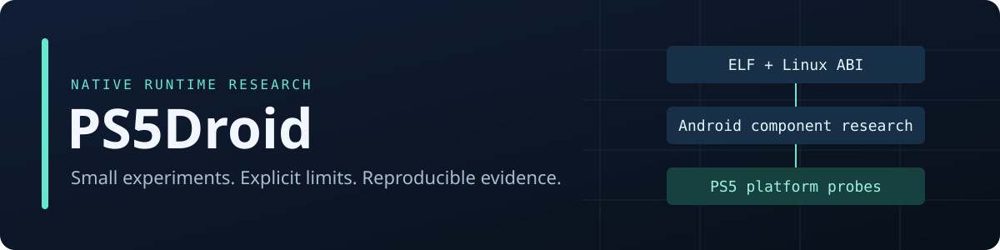

<div align="center">



**Native Android runtime research for jailbroken PlayStation 5 consoles.**

[Build & test](docs/development.md) · [Architecture](docs/architecture.md) · [Console validation](docs/console-validation.md) · [Execution boundary](docs/elf-execution.md)

</div>

> **Research status:** Android applications do not run yet. The repository contains
> host-tested components, an explicitly cooperative native ELF execution experiment,
> and an experimental PS5 payload. A host pass or successful cross-build does not
> establish console compatibility.

## What works, and what that proves

| Component | Implemented behavior | Evidence boundary |
| :--- | :--- | :--- |
| Platform | Memory, threads, filesystem, synchronization and framebuffer primitives | Host tests; console probes available |
| Linux ABI | Explicit Linux flag/errno translation, shared descriptor lifetimes, positioned reads, bounded memory semantics | Partial compatibility; inspect `--matrix` |
| Event loops | Blocking/nonblocking eventfd counters and level-triggered eventfd readiness | Other epoll targets and advanced modes fail explicitly |
| ELF | Bounded ELF64 parsing, address-correct stack staging, RX segment loading and cooperative syscall gateway | Trusted x86-64 fixture only; no unmodified bionic startup |
| Android package inspection | ZIP directory validation, stored/DEFLATE binary manifests, actual package/SDK/DEX/ABI metadata | Read-only inspection; no installation or signature verification |
| Binder research | Bounded synchronous in-process RPC with explicit errors and concurrent/reentrant tests | No Android Binder wire protocol or ServiceManager |
| PS5 payload | Video-out, DualSense input and machine-readable evidence capture | Cross-build evidence only until a hardware run is recorded |
| Graphics, audio and packaging | CPU framebuffer launcher | Android GPU services, audio output and PKG packaging remain unimplemented |

This project targets native PS5 homebrew. It does not boot Linux or bundle a VM,
Android system, Google Play Services, console keys or proprietary Sony SDKs.
Waydroid is an [architectural reference](docs/waydroid-analysis.md), not an imported runtime.

## Try the host research harness

Requires CMake ≥ 3.16, a C++17 compiler, zlib development files and Python 3 for tests.

```sh
cmake -S . -B build
cmake --build build
ctest --test-dir build --output-on-failure

./build/ps5droid-host --matrix
./build/ps5droid-host --inspect-apk tests/fixtures/aapt2-manifest.apk
./build/ps5droid-host --report-json build/host-evidence.json --probe-exec
./build/ps5droid-host --start-attempt
```

`--start-attempt` deliberately reports blockers. `--inspect-apk` reports the
manifest's package name and SDK levels; ZIP magic and filename substrings do not
establish a valid package. The fixture's metadata is independently checkable with
Android's AAPT2 or APK Analyzer.

### Execute the cooperative ELF fixture

On an x86-64 host with upstream LLVM Clang and LLD:

```sh
python3 tools/build_elf_fixture.py --output build/fixtures/cooperative.elf
./build/ps5droid-host --run-cooperative-elf build/fixtures/cooperative.elf
```

The expected path is **ELF entry → guest `write` → guest `exit_group` → return**.
The fixture is compiled for LLVM's Android target and explicitly calls a gateway
in place of raw syscall stubs. It has no bionic or Android framework dependency.
This is native machine-code execution, not proof that arbitrary Android binaries
can start. See the [execution contract and remaining blockers](docs/elf-execution.md).

## Build the experimental PS5 payload

Use the open-source [ps5-payload-sdk](https://github.com/ps5-payload-dev/sdk).
CI pins its release and SHA-256 in [`.github/ps5-sdk.json`](.github/ps5-sdk.json).

```sh
export PS5_PAYLOAD_SDK=/opt/ps5-payload-sdk
cmake -S . -B build-ps5 \
  -DCMAKE_TOOLCHAIN_FILE="$PS5_PAYLOAD_SDK/toolchain/prospero.cmake" \
  -DPS5DROID_BUILD_PS5=ON -DPS5DROID_SDK_VERSION=v0.45
cmake --build build-ps5 --target ps5droid
```

The output is `build-ps5/ps5droid.elf`, an ELF payload. Follow the
[console validation procedure](docs/console-validation.md) to deploy it, collect
`/data/ps5droid-evidence.json`, and record firmware/loader and repeat-launch results.
**No verified console result is included in this repository.**

## Development and evidence

- [Local validation record](docs/validation.md)
- [Architecture and milestone boundaries](docs/architecture.md)
- [Host builds, sanitizers, fuzzing and fixture provenance](docs/development.md)
- [Linux ABI and PS5 platform constraints](docs/platform-constraints.md)
- [Binder/RPC scope and concurrency contract](docs/binder-scope.md)
- [APK parser limits](docs/apk-inspection.md)
- [Hardware evidence checklist](docs/console-validation.md)

## License

PS5Droid is MIT-licensed. External references and linked dependencies are listed
in [THIRD_PARTY_NOTICES.md](THIRD_PARTY_NOTICES.md). No proprietary platform
components are downloaded or redistributed by the project.
