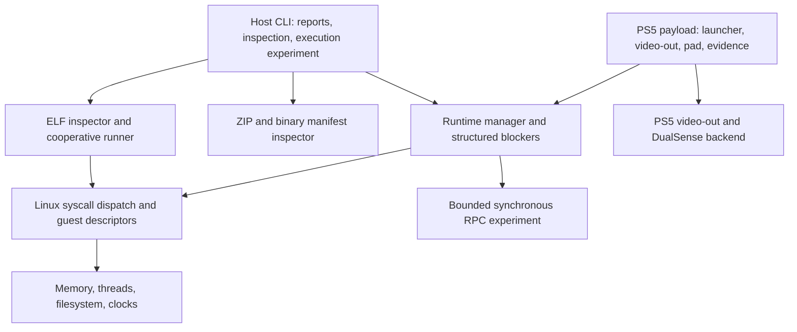

# Architecture and evidence boundaries

PS5Droid investigates Android component hosting inside a native PS5 homebrew
payload. Its layers are independently testable. A passing lower layer never
promotes the Android environment to `Running`.

## Contracts

| Layer | Contract | Deliberate boundary |
| --- | --- | --- |
| `platform/` | Native allocation, I/O, clocks and synchronization | Host success does not establish PS5 behavior |
| `compat/fd_table` | Explicit guest flags, native file descriptions, eventfd, limited readiness | No guest rootfs, pipe/socket routing or edge-triggered epoll |
| `compat/syscall_dispatch` | Linux numbers and guest structure layouts; `ret=-1` plus separate Linux `err` on failure | Ordinary pointer arguments remain trusted host pointers |
| `compat/bionic_loader` | Bounded header inspection and address-correct initial stack data | Minimal auxv; no complete bionic TLS/linker implementation |
| `compat/elf_runner` | Explicit cooperative entry and allowlisted syscall callback | No raw-syscall interception, relocations, process isolation or arbitrary binary support |
| `android/apk_inspector` | Read-only ZIP directory, binary XML and manifest metadata | No package installation, signature verification or resource reference resolution |
| `android/binder` | Bounded synchronous internal RPC | No Binder ioctl, Parcel wire compatibility or Android services |
| `android/runtime_manager` | Execute probes; return reasoned startup blockers | `Running` remains unreachable |
| `android/evidence_report` | Versioned JSON with backend, revision and measured observations | Unrecorded hardware facts remain unrecorded |

The cooperative gateway converts the dispatch result into raw Linux-style
negative errno values. The host C++ API keeps its existing separate `err` field.
Linux x86-64 `stat` and packed `epoll_event` layouts have compile-time size checks;
Linux flags and errno are translated instead of passed through as host values.

## Milestones

| Milestone | Evidence delivered | Remaining gate |
| --- | --- | --- |
| M1: foundation | Host tests and reproducible build workflows | Maintain host/console separation |
| M2: console | Payload and versioned evidence capture | Real console run, firmware/loader record and repeat-launch cleanup checks |
| M3: Linux ABI | Descriptor/memory fixes and eventfd readiness tests | Broader process, signal, filesystem and event-loop compatibility |
| M4: executable loading | ELF validation, stack staging and trusted cooperative execution experiment | Unmodified bionic, TLS, dynamic linking/relocations and raw syscall routing |
| M5: Binder | Bounded internal RPC with concurrent/reentrant/error tests | Android Binder compatibility and service implementation |
| M6: package inspection | ZIP/AXML metadata checked against an AAPT2-authored fixture | Android environment startup and application execution |

A native machine-code fixture and an internal RPC callback are useful evidence
for their own contracts. Neither closes the bionic or Binder compatibility gate.
Firmware declarations cite the public SDK and SDL port; they still need runtime
validation on every claimed console configuration.

Related: [ELF execution](elf-execution.md), [RPC scope](binder-scope.md),
[APK limits](apk-inspection.md), [console evidence](console-validation.md).
